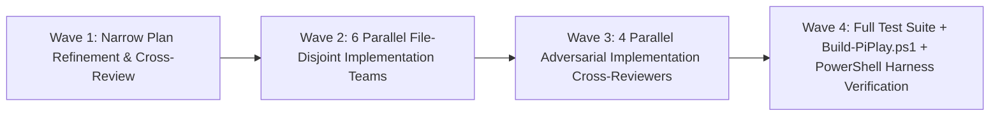

# PiPlay Test Suite Audit, Blind-Spot Analysis & Remediation Plan

**Date:** 2026-10-19  
**Scope:** All test files and infrastructure helpers in `tests/PiPlay.Tests/`, cross-referenced against all production code in `src/PiPlay/` and PowerShell release scripts in `scripts/`.  
**Status:** Implemented, Cross-Reviewed & Verified (`0 Warning(s), 0 Error(s)`, `1,045 passed, 0 failed`)

---

## 1. Executive Summary

A full, narrow-pass audit across all **1,189 tests** in `tests/PiPlay.Tests/` and their production counterparts in `src/PiPlay/` revealed that while the suite has strong foundational coverage, a significant portion of the test count consists of:
1. **Always-Positive / Tautological / Mirage Tests** that will pass even if the production feature they claim to test is deleted or broken.
2. **Critical Blind Spots** where test harnesses or weak assertions bypass the real production code paths (`buildRoot()` in `YouTubeDomBridge`, template `<Border x:Name="bd">` in `ThemeCardToggle`, `StripAutoHide` overrides, `0x0` window clamping, L-shaped resize corner interiors, and unexecuted PowerShell behavioral test harnesses).
3. **Ghost / Dead-Code Tests** that exclusively test production classes, methods, or overloads with **zero callers in `src/PiPlay/`** (plus 5 `*ForTests` properties with zero callers anywhere in the repository).
4. **Pure Duplicate / Fragmented Tests** across `WpfRuntimeTests.cs`, `XamlInvariantTests.cs`, `PlayerSurfaceScriptTests.cs`, `SettingsServiceTests.cs`, and smaller fixtures that inflate STA window creations, disk I/O, and external `pwsh` process spawns without adding coverage.

---

## 2. Highlighted Blind Spots (Where Bugs Can Slip Past Green Tests Today)

> [!IMPORTANT]
> Each blind spot below is currently **masked by a green test** that appears to cover the scenario on paper, creating false confidence.

### Blind Spot 1: `YouTubeDomBehaviorHarness.cjs` Short-Circuits `buildRoot()` and Never Runs `BuildPlayerFirstConfigurationScript`
- **Location:** [`tests/PiPlay.Tests/Infrastructure/YouTubeDomBehaviorHarness.cjs:337-340, 385-413`](file:///d:/Development/DesktopApps/PiPlay/tests/PiPlay.Tests/Infrastructure/YouTubeDomBehaviorHarness.cjs#L337-L340) vs [`src/PiPlay/Services/YouTubeDomBridge.cs:528-561, 884, 996-1015`](file:///d:/Development/DesktopApps/PiPlay/src/PiPlay/Services/YouTubeDomBridge.cs#L884)
- **Why it is a blind spot:**
  - In `YouTubeDomBehaviorHarness.cjs:337-340`, `createEnvironment({ includeFocusedRoot: true })` pre-creates and attaches `#piplay-focused-overlay` with hand-constructed child elements *before* executing `focusedScript`.
  - When `YouTubeDomBridge`'s `install()` runs `root = document.getElementById(ROOT_ID) || buildRoot();` (`YouTubeDomBridge.cs:884`), `document.getElementById("piplay-focused-overlay")` returns the harness-built fake element and **completely skips `buildRoot()` and `button()` (`YouTubeDomBridge.cs:528-561`)**!
  - Furthermore, `YouTubeDomBehaviorTests.cs:23-35` never passes `YouTubeDomBridge.BuildPlayerFirstConfigurationScript` into the Node harness, so runtime `configure({ topmost, maximized, accentHex, fadeEnabled, fadeDelayMs })` updates are never executed in Node.
  - Because `buildRoot()` was skipped in Node, 17 static substring-grep tests were added in `PlayerSurfaceScriptTests.cs` and `FocusedPinAffordanceScriptTests.cs` (`Assert.Contains("button(\"", script)`), which only check literal C# string templates rather than DOM behavior.
- **Remediation:**
  - Teach `FakeElement.innerHTML` in `YouTubeDomBehaviorHarness.cjs` to parse the `[data-action]` buttons, `[data-action="seek"]` input, and `[data-time]` spans emitted by `buildRoot()`, and stop pre-seeding `#piplay-focused-overlay` so `install()` executes the real `buildRoot()` and `button()` functions.
  - Pass and execute `BuildPlayerFirstConfigurationScript` in `YouTubeDomBehaviorHarness.cjs` (testing `topmost: true/false`, `maximized: true/false`, zero-volume unmute recovery, seek rail fill, and idle-fade timer transitions), allowing `FocusedPinAffordanceScriptTests.cs` and `PlayerSurfaceScriptTests.cs` to be retired or reduced to a minimal parameter-escaping check.

### Blind Spot 2: `SettingsWindow_theme_preset_cards_preserve_distinct_preview_backgrounds_when_checked` Checks the Wrong Element
- **Location:** [`tests/PiPlay.Tests/Ui/SettingsWindowAppearanceTests.cs:247-262`](file:///d:/Development/DesktopApps/PiPlay/tests/PiPlay.Tests/Ui/SettingsWindowAppearanceTests.cs#L247-L262) vs [`src/PiPlay/SettingsWindow.xaml:36, 51-77`](file:///d:/Development/DesktopApps/PiPlay/src/PiPlay/SettingsWindow.xaml#L36-L77)
- **Why it is a blind spot:**
  - The bug `ThemeCardToggle` was created to prevent is `PresetToggle`'s `<Trigger Property="IsChecked" Value="True">`, which sets `TargetName="bd" Property="Background" Value="{DynamicResource AccentSubtle}"` on the template's inner `<Border x:Name="bd">`.
  - That trigger **never** modifies the outer `ToggleButton.Background` dependency property.
  - However, `SettingsWindowAppearanceTests.cs:259-261` never calls `ApplyTemplate()` and never inspects `Template.FindName("bd", card)` — it asserts `sharpCard.Background`, `minimalCard.Background`, and `glassCard.Background` on the outer `ToggleButton`, which is **always** `#0B0E12` / `#1B1510` / `#0E1726` even if `ThemeCardToggle`'s template were completely deleted!
- **Remediation:**
  - Call `ApplyTemplate()` on all three cards, look up `(Border)card.Template.FindName("bd", card)!`, and assert that `bd.Background` retains each preset's distinct surface hex (`#0B0E12`, `#1B1510`, `#0E1726`) both when unchecked and when `IsChecked == true`.

### Blind Spot 3: Non-Discriminating `StripAutoHide = true` in Theme Resolver & Writer Tests
- **Location:** [`tests/PiPlay.Tests/ThemePreferenceResolverTests.cs:20, 25, 36, 41, 76, 83`](file:///d:/Development/DesktopApps/PiPlay/tests/PiPlay.Tests/ThemePreferenceResolverTests.cs#L20-L42) and [`tests/PiPlay.Tests/ThemeSettingsWriterTests.cs:147, 154, 162`](file:///d:/Development/DesktopApps/PiPlay/tests/PiPlay.Tests/ThemeSettingsWriterTests.cs#L147-L162)
- **Why it is a blind spot:**
  - Every preset in [`ThemeCatalog.cs:201, 227, 252`](file:///d:/Development/DesktopApps/PiPlay/src/PiPlay/Theme/ThemeCatalog.cs#L201-L252) (`sharp-dark`, `minimal`, `soft-glass`) has `DefaultStripAutoHide = true`.
  - In `Preset_defaults_apply_when_overrides_are_null` (`ThemePreferenceResolverTests.cs:20`), `player.StripAutoHide` is set to `true` (same as `preset.DefaultStripAutoHide`). If `ThemePreferenceResolver.StripAutoHide` leaked `player.StripAutoHide` when `theme.StripAutoHide` is `null`, the test would still pass!
  - In `Explicit_overrides_win_over_preset_defaults` (`ThemePreferenceResolverTests.cs:36`), `theme.StripAutoHide` is set to `true` (same as `preset.DefaultStripAutoHide`). If `ThemePreferenceResolver.StripAutoHide` ignored `theme.StripAutoHide` and always returned the preset default, the test would still pass!
  - In `ThemeSettingsWriterTests.cs:147, 154, 162`, `stripAutoHideOverride: true` is passed for `"sharp-dark"` (whose default is already `true`), so `Assert.True(settings.Player.StripAutoHide)` passes even if the override is dropped!
- **Remediation:**
  - Flip the discriminating values in all four tests (`player.StripAutoHide = false` when testing preset default `true`; `theme.StripAutoHide = false` and `player.StripAutoHide = true` when testing explicit override `false`; `stripAutoHideOverride: false` in `ThemeSettingsWriterTests`).

### Blind Spot 4: `Return_on_the_same_video_seeks_rather_than_navigates` Never Executes the Seek Branch
- **Location:** [`tests/PiPlay.Tests/Ui/WpfRuntimeTests.cs:2437-2454`](file:///d:/Development/DesktopApps/PiPlay/tests/PiPlay.Tests/Ui/WpfRuntimeTests.cs#L2437-L2454) vs [`src/PiPlay/MainWindow.xaml.cs:1982, 2024-2029`](file:///d:/Development/DesktopApps/PiPlay/src/PiPlay/MainWindow.xaml.cs#L1982)
- **Why it is a blind spot:**
  - On an unshown `MainWindow`, `Browser.CoreWebView2` (`core`) is `null`.
  - In `MainWindow.ApplyReturnActionAsync` (`MainWindow.xaml.cs:2024-2029`), both `ReturnAction.SeekAndPlay when core is not null` and `ReturnAction.Seek when core is not null` are guarded by `when core is not null` and are **completely skipped** during the test!
  - The test asserts `Assert.Null(w.PendingUrlForTests); // the seek path scripts a live core instead`, which is `null` by default and would still pass if the `SeekAndPlay` and `Seek` cases were deleted from `ApplyReturnActionAsync`.
- **Remediation:**
  - Consolidate the `ApplyReturnActionAsync` tests on a single `MainWindow` instance and either record the last return action / seek target when `core is null` or honestly name the test for what it verifies (that same-video return does not queue a navigation URL or overwrite `_pendingUrl` and updates `AutoLastHandledVideoId`).

### Blind Spot 5: Weak Inequality Assertions in `PlacementMathTests` and Non-Finite `DpiScale` in `EnsureMinSize`
- **Location:** [`tests/PiPlay.Tests/PlacementMathTests.cs:18-26, 46-55, 92-100`](file:///d:/Development/DesktopApps/PiPlay/tests/PiPlay.Tests/PlacementMathTests.cs#L46-L55) and [`src/PiPlay/Services/PlacementMath.cs:45`](file:///d:/Development/DesktopApps/PiPlay/src/PiPlay/Services/PlacementMath.cs#L45)
- **Why it is a blind spot:**
  - `Clamps_onto_a_secondary_monitor_work_area` (`PlacementMathTests.cs:53-54`) only asserts `c.Left >= work2.Left && c.Right <= work2.Right` and `c.Top >= work2.Top && c.Bottom <= work2.Bottom`. It never checks `Width`, `Height`, or exact coordinates — a broken `Clamp` returning a `0x0` rectangle at `(1920, 0, 1920, 0)` passes!
  - `Offscreen_right_is_pulled_back_onto_the_monitor` (`PlacementMathTests.cs:23`) only asserts `c.Right <= Work.Right`, which passes even if `Clamp` shifts the window to the left edge (`Left = 0`) instead of the right edge (`Left = 960`).
  - In production [`PlacementMath.EnsureMinSize` (`PlacementMath.cs:45`)](file:///d:/Development/DesktopApps/PiPlay/src/PiPlay/Services/PlacementMath.cs#L45), `var scale = data.DpiScale > 0 ? data.DpiScale : 1.0;` does **not** check `double.IsFinite(data.DpiScale)` (unlike `ToDipSize` at `PlacementMath.cs:132`), so `DpiScale = double.PositiveInfinity` produces `(int)Math.Round(double.PositiveInfinity)` (overflow / `int.MinValue`)!
- **Remediation:**
  - Add `&& double.IsFinite(data.DpiScale)` to `PlacementMath.EnsureMinSize` (`PlacementMath.cs:45`), add `[InlineData(double.NaN)]` / `[InlineData(double.PositiveInfinity)]` tests, and replace the inequality assertions in `PlacementMathTests.cs:23, 53-54` with exact `Assert.Equal(new RectI(...), c)` checks.

### Blind Spot 6: Missing Interior-Corner Exclusion Check in `BorderlessResizeHitTestPolicyTests`
- **Location:** [`tests/PiPlay.Tests/BorderlessResizeHitTestPolicyTests.cs:56-68`](file:///d:/Development/DesktopApps/PiPlay/tests/PiPlay.Tests/BorderlessResizeHitTestPolicyTests.cs#L56-L68) vs [`src/PiPlay/Services/BorderlessResizeHitTestPolicy.cs:49-54`](file:///d:/Development/DesktopApps/PiPlay/src/PiPlay/Services/BorderlessResizeHitTestPolicy.cs#L49-L54)
- **Why it is a blind spot:**
  - `BorderlessResizeHitTestPolicy.HitTest` implements L-shaped edge-band corners (`(onTop && nearLeftCorner) || (onLeft && nearTopCorner)`) so a `96x96` square in the top-right corner does not swallow clicks on caption buttons (`CloseButton`, `MaximizeButton`, `SettingsButton`).
  - However, no test checks a point inside the `96x96` corner square but outside the `12 DIP` edge band (e.g. `(Corner / 2, Corner / 2)` = `(48, 48)` or `(Width - 48, 20)`). If `(onTop && nearRightCorner) || (onRight && nearTopCorner)` were accidentally changed to `nearRightCorner && nearTopCorner`, every test in `BorderlessResizeHitTestPolicyTests.cs` would still pass while breaking all top-right caption buttons!
- **Remediation:**
  - Assert `Assert.Null(HitTest(Corner / 2, Corner / 2))`, `Assert.Null(HitTest(Width - Corner / 2, Corner / 2))`, `Assert.Null(HitTest(Corner / 2, Height - Corner / 2))`, and `Assert.Null(HitTest(Width - Corner / 2, Height - Corner / 2))` in `Corners_extend_along_the_edge_band`.

### Blind Spot 7: `PopoutTargetResolverTests` Misses `[Trait]`, Canonical Playlist Fallback, and Empty-Video Guard
- **Location:** [`tests/PiPlay.Tests/PopoutTargetResolverTests.cs:6, 30-53, 196-203`](file:///d:/Development/DesktopApps/PiPlay/tests/PiPlay.Tests/PopoutTargetResolverTests.cs#L6) vs [`src/PiPlay/Services/PopoutTargetResolver.cs:14-22, 77-88`](file:///d:/Development/DesktopApps/PiPlay/src/PiPlay/Services/PopoutTargetResolver.cs#L14-L22)
- **Why it is a blind spot:**
  1. `PopoutTargetResolverTests` (`line 6`) is the **only** test class in the entire test suite without a `[Trait(TestCategories.Key, ...)]` attribute, so running `dotnet test --filter Category=Logic` silently skips the entire class!
  2. Both `Source_playlist_fallback_is_preserved_when_neither_surface_has_a_video` (`L30-40`) and `Current_source_playlist_wins_over_a_stale_spa_canonical_video` (`L42-53`) pass `"https://www.youtube.com/playlist?list=PLabc"` as `currentSource` (the 1st argument), which returns immediately at `PopoutTargetResolver.cs:15`. Neither test exercises `line 22` (where `currentSource` is `"https://www.youtube.com/"` and `canonical` is a playlist URL). Also, `PopoutTargetResolver.cs:21` (`if (hasSource) return fromSource;`) is dead/unreachable because `YouTubeUrlHelper.TryParse` only returns `true` when `VideoId` is non-empty or `IsPlaylistOnly` is `true` (already returned at `line 15`).
  3. `There_is_nothing_to_honor_without_a_captured_video` (`L201-202`) passes `Target("https://www.youtube.com/playlist?list=PLabc")` (`IsPlaylistOnly = true`), which enters `if (captured.IsPlaylistOnly)` at `PopoutTargetResolver.cs:77` (already tested at `L170`) and **never reaches `PopoutTargetResolver.cs:87` (`if (string.IsNullOrEmpty(captured.VideoId)) return false;`)**!
- **Remediation:**
  - Add `[Trait(TestCategories.Key, TestCategories.Logic)]` to `PopoutTargetResolverTests`.
  - Test `Resolve("https://www.youtube.com/", "https://www.youtube.com/playlist?list=PLabc")` and remove the unreachable `if (hasSource) return fromSource;` line at `PopoutTargetResolver.cs:21`.
  - Pass `new YouTubeTarget()` in `There_is_nothing_to_honor_without_a_captured_video` (`L202`) so `PopoutTargetResolver.cs:87` is actually exercised.

### Blind Spot 8: Vacuous Loops (`0` Iterations) and Unanchored Queries in `XamlInvariantTests.cs`
- **Location:** [`tests/PiPlay.Tests/Ui/XamlInvariantTests.cs:88-97, 474-502, 646-683, 718-813`](file:///d:/Development/DesktopApps/PiPlay/tests/PiPlay.Tests/Ui/XamlInvariantTests.cs#L474-L502)
- **Why it is a blind spot:**
  - `Glyph_controls_use_the_icon_font` (`L483-490`): The first `foreach` loop over `<TextBlock>` elements with PUA codepoints (`>= 0xE000`) has no `Assert.NotEmpty` and runs **0 times** on `PlayerWindow.xaml` and **0 times** on `SettingsWindow.xaml`.
  - `No_hardcoded_corner_radii_outside_the_token_dictionary` (`L780-813`): Runs **0 times** on `PlayerWindow.xaml` (which has no control `CornerRadius` attributes) while omitting `Controls/AccentColorPicker.xaml` (which has 3 `CornerRadius` attributes).
  - `Every_StaticResource_reference_is_defined` (`L718-743`) and `Every_DynamicResource_reference_is_defined_in_a_reachable_scope` (`L746-776`) hardcode the XAML file list and **omit `Controls/AccentColorPicker.xaml`**, so a broken `{StaticResource}` or `{DynamicResource}` in `AccentColorPicker.xaml` would pass both tests!
  - `Theme_preset_cards_advertise_the_opacity_the_preset_actually_applies` (`L646-662`) and `Theme_preset_swatches_paint_the_preset_default_accent` (`L664-683`) dump all `TextBlock.Text` and `Border.Background` values across the entire `SettingsWindow.xaml` into flat `HashSet`s instead of anchoring them to `ThemeSharpDarkPreset`, `ThemeMinimalPreset`, and `ThemeSoftGlassPreset`. Swapping the labels or swatches between cards would pass!
  - `Caption_buttons_leave_the_top_right_resize_corner_clear` (`L88-97`) checks if *any* `StackPanel` in the window has `Margin="0,0,12,0"` / `"0,0,10,0"` without checking that it is the title bar `StackPanel` containing `CloseButton`.

### Blind Spot 9: Existing Behavioral PowerShell Test Harnesses Are Never Executed in CI or `dotnet test`
- **Location:** `scripts/Test-PublishLock.ps1` (117 lines), `scripts/Test-DeploySwap.ps1` (253 lines), `scripts/Test-PublishMetadata.ps1` (186 lines) vs [`tests/PiPlay.Tests/ReleaseScriptPolicyTests.cs:204-296`](file:///d:/Development/DesktopApps/PiPlay/tests/PiPlay.Tests/ReleaseScriptPolicyTests.cs#L204-L296)
- **Why it is a blind spot:**
  - The repository contains three real, behavioral PowerShell test suites (`Test-PublishLock.ps1` testing cross-process mutexes and abandoned mutex recovery; `Test-DeploySwap.ps1` testing 8 staging/verification/rollback scenarios A–H; `Test-PublishMetadata.ps1` testing manifest SHA256/size verification).
  - However, **none of those three test scripts are run by `Test-LocalCI.ps1`, `.github/workflows/ci.yml`, or `dotnet test`**! Instead, `ReleaseScriptPolicyTests.cs:204-296` only greps `PublishLock.ps1` and `DeploySwap.ps1` as text strings (e.g. `publish.IndexOf("\ntry {")`, which breaks on indentation changes while never running the actual PowerShell code).

---

## 3. Complete Inventory of Useless, Always-Positive, Ghost & Duplicate Tests

### 3.1 Entire Test Files Recommended for Removal or Replacement

| Test File | Lines / Tests | Reason | Action |
| :--- | :--- | :--- | :--- |
| [`tests/PiPlay.Tests/ContrastReportTests.cs`](file:///d:/Development/DesktopApps/PiPlay/tests/PiPlay.Tests/ContrastReportTests.cs) | 76 lines (2 tests) | Scratchpad that calls test-only `Wcag.ContrastRatio` on hardcoded hex strings (with stale `#00D4FF` install-default comment and commented-out Phase-B rows); duplicates `ThemeCatalogTests.Preset_palettes_meet_contrast_minimums`. | **Delete file** |
| [`tests/PiPlay.Tests/AccentWashBrushConverterTests.cs`](file:///d:/Development/DesktopApps/PiPlay/tests/PiPlay.Tests/AccentWashBrushConverterTests.cs) | 43 lines (3 tests) | Tests [`AccentWashBrushConverter`](file:///d:/Development/DesktopApps/PiPlay/src/PiPlay/Theme/AccentWashBrushConverter.cs), which has **0 consumers in `src/PiPlay/`** (`ProfileIdentityRow` uses `ContrastBrushConverter`, which has 0 unit tests). | **Replace with `ContrastBrushConverterTests.cs`** (and remove dead `AccentWashBrushConverter` & `ProfileRowWashAlpha`) |
| [`tests/PiPlay.Tests/AppStartupArgumentTests.cs`](file:///d:/Development/DesktopApps/PiPlay/tests/PiPlay.Tests/AppStartupArgumentTests.cs) | 71 lines (5 tests) | Tests [`App.ExtractUrlArg`](file:///d:/Development/DesktopApps/PiPlay/src/PiPlay/App.xaml.cs#L163-L164), which has **0 callers in `src/PiPlay/`** and duplicates [`StartupArgumentPolicyTests.cs`](file:///d:/Development/DesktopApps/PiPlay/tests/PiPlay.Tests/StartupArgumentPolicyTests.cs). | **Delete file** (fold any missing URL shapes into `StartupArgumentPolicyTests.cs` & delete dead `App.ExtractUrlArg`) |
| [`tests/PiPlay.Tests/FocusedPinAffordanceScriptTests.cs`](file:///d:/Development/DesktopApps/PiPlay/tests/PiPlay.Tests/FocusedPinAffordanceScriptTests.cs) | 21 lines (1 test) | Static `Assert.Contains` on un-interpolated JS lines in `YouTubeDomBridge.cs`. | **Delete file** (verify pin state/labels behaviorally in `YouTubeDomBehaviorHarness.cjs`) |
| [`tests/PiPlay.Tests/WindowBorderColorPolicyTests.cs`](file:///d:/Development/DesktopApps/PiPlay/tests/PiPlay.Tests/WindowBorderColorPolicyTests.cs) | 22 lines (1 test) | Tests 1-line `suppress && !highContrast` helper; trivial to fold into `WindowOpacityPolicyTests.cs`. | **Merge into `WindowOpacityPolicyTests.cs` & delete file** |

---

### 3.2 Dead Production Code in `src/PiPlay/` Exercised Only by Tests (or by Nothing)

| Production Symbol (`src/PiPlay/`) | Callers in `src/PiPlay/` | Callers in `tests/PiPlay.Tests/` | Remediation |
| :--- | :--- | :--- | :--- |
| `AccentWashBrushConverter` (`Theme/AccentWashBrushConverter.cs:13-31`) & `ProfileRowWashAlpha` (`Colors.xaml:67`, `ThemeResourceApplier.cs:79-80`, `ControlStyles.xaml:19`) | **0** | `AccentWashBrushConverterTests.cs:17` | Remove dead converter/resource & replace test file with `ContrastBrushConverterTests.cs` |
| `App.ExtractUrlArg(string[])` (`App.xaml.cs:163-164`) | **0** | `AppStartupArgumentTests.cs:26, 44, 53, 61, 67, 68` | Remove dead method & `AppStartupArgumentTests.cs` |
| `FadePolicy.ShouldShow(...)` (`Services/FadePolicy.cs:42-46`) | **0** | `FadePolicyTests.cs:45-67` (4 tests) | Remove dead method & its 4 tests |
| `YouTubeUrlHelper.BuildEmbedUrl(...)` (`Services/YouTubeUrlHelper.cs:105-119`) | **0** | `YouTubeUrlHelperTests.cs:94, 99, 201-208` | Remove dead method & its tests |
| `PlayerAppearancePolicy.AccentOptions` (`L28`), `BrushResourceKeyFor` (`L41-45`), `DisplayNameForAccent` (`L47-51`) | **0** | `PlayerAppearancePolicyTests.cs:20-29` (`BrushResourceKeyFor` only; `AccentOptions` & `DisplayNameForAccent` have 0 callers anywhere) | Remove dead members & `BrushResourceKeyFor` test |
| `RoundedWindowRegionPolicy.ShouldApply(...)` (`Services/RoundedWindowRegionPolicy.cs:25-30`) | **0** (`CanApply` is used) | `RoundedWindowRegionPolicyTests.cs:10-25` | Remove dead method & its duplicate test |
| `ThemeColors.Lighten(Color, double)` (`Theme/ThemeColors.cs:41-48`) | **0** (`Mix` is used) | `ThemeColorsTests.cs:313-323` | Remove dead method & its test |
| `ProfileService.Exists(AppSettings, string)` (`Services/ProfileService.cs:29`) | **0** (`Find` is used) | `ProfileServiceTests.cs:22, 24` | Remove dead method & assert `Find` directly |
| `ReturnPolicy.Decide(int?, bool)` (`L27-28`) & `Decide(int?, bool, string?, string?)` (`L44-46`) | **0** (6-arg overload is used) | `ReturnPolicyTests.cs:17, 56` | Remove dead 2-arg/4-arg overloads & test the live 6-arg entry point |
| `PlayerShellBridge.Play()`, `Pause()`, `Seek(int)`, `RequestState()`, `Post(string)` (`Services/PlayerShellBridge.cs:40-49, 97-102`) | **0** | **0** | Remove dead outbound host$\rightarrow$shell methods |
| `PlayerShellProtocol.Play()`, `Pause()`, `RequestState()`, `Seek(int)`, `Command(string)` (`Services/PlayerShellProtocol.cs:130-142`) & `postRequest(action)` (`PlayerShell/player-shell.js:25-28`) | **0** | `PlayerShellProtocolTests.cs:177-228`, `PlayerShellAssetTests.cs:69-118` | Remove dead outbound protocol commands & their tests |
| `MainWindow.BrowserDataClearInProgressForTests` (`MainWindow.xaml.cs:949`) & `PlayerWindow.ReturnPausedForTests`, `ReturnVolumeForTests`, `ReturnMutedForTests`, `ReturnPlaybackRateForTests` (`PlayerWindow.xaml.cs:697-700`) | **0** | **0** | Remove the 5 unused `*ForTests` properties |
| `WindowOpacityApplier.DisableBorderSuppressionTrackingForTests()` & `BorderSuppressionEntryCountForTests()` (`Services/WindowOpacityApplier.cs:207-208`) | **0** | `WpfRuntimeTests.cs:1710, 1725` (self-referential test of test-only dict) | Remove both methods & `Border_color_records_nothing_in_the_production_default` |
| `MainWindow.CanClearBrowserData` (`MainWindow.xaml.cs:946-947`) & `MainWindow.ApplyPopoutActionState(bool)` (`L1743-1744`) & `PlayerWindow.ApplyCornerMode(DwmCornerMode)` (`PlayerWindow.xaml.cs:1131-1134`) | **0** (production inlines or calls sibling overloads) | `WpfRuntimeTests.cs:1077, 1156, 1785` | Route production callers through `CanClearBrowserData`, or test the live `ApplyCornerAppearance` method |
| `YouTubeDomBridge.SuppressPlaybackAsync(Func<string, Task<string>>, TimeSpan?)` (`Services/YouTubeDomBridge.cs:134-147`) | **0** (`SuppressPlaybackAsync(CoreWebView2)` at `L127` did not delegate to it!) | `RuntimeFailurePolicyTests.cs:29-74` | Make `SuppressPlaybackAsync(CoreWebView2)` (`L127`) delegate to `SuppressPlaybackAsync(script => ExecuteRawAsync(webView, script))` so the tested method is the actual production code path! |

---

### 3.3 Itemized File-by-File Test Cleanup & Strengthening Matrix

#### A. Logic & Policy Unit Tests (`tests/PiPlay.Tests/*.cs`)

1. **[`AppChannelTests.cs`](file:///d:/Development/DesktopApps/PiPlay/tests/PiPlay.Tests/AppChannelTests.cs#L20-L34)**
   - Merge the four 1-line `Resolve_*` `[Fact]`s (`L20-34`) into a single `[Theory]` and add `[InlineData("Default", "Stable", PiPlayChannel.Default)]` so a broken implementation returning `Stable` whenever either argument is `"Stable"` cannot pass.
2. **[`AppInfoTests.cs`](file:///d:/Development/DesktopApps/PiPlay/tests/PiPlay.Tests/AppInfoTests.cs#L8-L22)**
   - Merge the four 1-line `FormatTitle` `[Fact]`s (`L8-22`) into a single `[Theory]`, and add a `[Fact]` verifying `AppInfo.Version` (`"0.14.0"`), `AppInfo.BuildNumber` (`40`), and `AppInfo.WindowTitle`.
3. **[`AppPathsTests.cs`](file:///d:/Development/DesktopApps/PiPlay/tests/PiPlay.Tests/AppPathsTests.cs#L25-L71)**
   - In `Root_falls_back_to_localappdata_when_unset` (`L25-38`), also save/clear/restore `PIPLAY_CHANNEL` and assert `Assert.Equal(Path.Combine(Environment.GetFolderPath(Environment.SpecialFolder.LocalApplicationData), "PiPlay"), AppPaths.Root)`.
   - Merge the four `ResolveRoot_*` `[Fact]`s (`L42-71`) into a single `[Theory]`.
4. **[`StartupArgumentPolicyTests.cs`](file:///d:/Development/DesktopApps/PiPlay/tests/PiPlay.Tests/StartupArgumentPolicyTests.cs#L65-L136)**
   - Merge `Supported_explicit_target_is_preserved` (`L93-104`) and `Supported_scheme_less_target_is_preserved_for_shared_navigation_parsing` (`L106-117`) (plus the `shorts/`, `live/`, `playlist?list=` cases from deleted `AppStartupArgumentTests.cs`).
   - Merge `Empty_argument_list_starts_normally_without_a_url` (`L65-72`) and `No_launch_candidate_starts_normally_without_a_url` (`L74-81`).
5. **[`NavigationPolicyTests.cs`](file:///d:/Development/DesktopApps/PiPlay/tests/PiPlay.Tests/NavigationPolicyTests.cs#L39-L113)**
   - Fold the rejected hosts from `Google_auth_host_matching_is_precise` (`L69-72`) and `Other_or_lookalike_local_hosts_are_never_allowed` (`L105-113`) into `Other_sites_blocked_everywhere` (`L39-49`), and assert `NavigationSurface.Player` alongside `Source` in `Null_uri_is_not_allowed` (`L87-91`).
6. **[`PopoutNavigationPolicyTests.cs`](file:///d:/Development/DesktopApps/PiPlay/tests/PiPlay.Tests/PopoutNavigationPolicyTests.cs#L10-L33)**
   - Merge `Mix_radio_lists_retarget_with_the_mix_kept` (`L23-33`) into `Playable_targets_retarget_in_place` (`L10-21`) and assert `target.PlaylistId` and `target.StartSeconds`.
7. **[`PopoutTargetResolverTests.cs`](file:///d:/Development/DesktopApps/PiPlay/tests/PiPlay.Tests/PopoutTargetResolverTests.cs#L6-L203)**
   - Add `[Trait(TestCategories.Key, TestCategories.Logic)]` (`L6`).
   - Test `PopoutTargetResolver.Resolve("https://www.youtube.com/", "https://www.youtube.com/playlist?list=PLabc")` (`L33-35`) to cover the canonical playlist fallback (`PopoutTargetResolver.cs:22`), and test `Resolve("https://www.youtube.com/", "https://www.youtube.com/") == null`.
   - Pass `new YouTubeTarget()` at `L202` to exercise `PopoutTargetResolver.cs:87`.
8. **[`ReturnPolicyTests.cs`](file:///d:/Development/DesktopApps/PiPlay/tests/PiPlay.Tests/ReturnPolicyTests.cs#L8-L66)**
   - Route all `ReturnPolicy.Decide` test rows through the live 6-parameter `ReturnPolicy.Decide` method and delete the duplicate `Same_video_with_returned_paused_state_uses_the_popout_state` (`L59-66`) and dead 2-arg/4-arg overloads.
9. **[`YouTubeUrlHelperTests.cs`](file:///d:/Development/DesktopApps/PiPlay/tests/PiPlay.Tests/YouTubeUrlHelperTests.cs#L8-L249)**
   - Delete `Builds_embed_url_with_autoplay_playlist_and_start` (`L201-208`) and the `BuildEmbedUrl` assertions at `L94, 99`.
   - Delete `Parses_path_based_v_and_live_ids` (`L146-153`, exact duplicate of `L8-20`).
   - Delete `Shell_url_host_is_the_single_source_of_truth_allowlisted_on_the_player` (`L238-249`, duplicates `NavigationPolicyTests.cs:95-103`).
10. **[`BorderlessResizeHitTestPolicyTests.cs`](file:///d:/Development/DesktopApps/PiPlay/tests/PiPlay.Tests/BorderlessResizeHitTestPolicyTests.cs#L27-L90)**
    - Delete `Owner_tuned_resize_target_keeps_12_DIP_edges_and_96_DIP_corners` (`L27-32`, pure constant check).
    - Fold `Assert.Null(HitTest(MidX, MidY))` into `Resize_zones_start_exactly_at_the_configured_border` (`L43-54`) and delete duplicate `Interior_and_outer_border_boundary_points_are_client_area` (`L82-90`).
    - Add interior-corner `Assert.Null(HitTest(Corner / 2, Corner / 2))` checks to `Corners_extend_along_the_edge_band` (`L56-68`).
11. **[`BorderlessWindowHelperTests.cs`](file:///d:/Development/DesktopApps/PiPlay/tests/PiPlay.Tests/BorderlessWindowHelperTests.cs#L133-L187)**
    - At `L133`, assert the expected packed `lParam` value (`new IntPtr((340 << 16) | (-1920 & 0xFFFF))`) without calling `PackScreenPointForTests` on both sides of `Assert.Equal`.
    - At `L180-186`, assert that `ProcessMoveSizeMessageForTests` returns `true` even when the callback throws.
12. **[`FadePolicyTests.cs`](file:///d:/Development/DesktopApps/PiPlay/tests/PiPlay.Tests/FadePolicyTests.cs#L11-L67)**
    - Delete the 4 dead `ShouldShow_*` tests (`L45-67`) and merge the 5 `ShouldHide_*` `[Fact]`s (`L11-41`) into a single `[Theory]`.
13. **[`LoggingServiceTests.cs`](file:///d:/Development/DesktopApps/PiPlay/tests/PiPlay.Tests/LoggingServiceTests.cs#L15-L122)**
    - Merge the 4 `RedactUrl_*` tests (`L15-45`) into a single `[Theory]` asserting exact `Assert.Equal(expected, Log.RedactUrl(input))` (removing the vacuous `DoesNotContain` after `Equal`).
    - Merge `Exception_overload_records_the_type_and_message` (`L111-122`) into `Queued_entries_reach_the_file` (`L80-94`).
14. **[`PlacementMathTests.cs`](file:///d:/Development/DesktopApps/PiPlay/tests/PiPlay.Tests/PlacementMathTests.cs#L18-L119)**
    - Strengthen `L23-25` and `L53-54` to assert exact `RectI` equality (`new RectI(960, 100, 1920, 640)` and `new RectI(2880, 540, 3840, 1080)`).
    - Merge `EnsureMinSize_preserves_monitor_and_maximized_metadata` (`L102-119`) into `EnsureMinSize_raises_a_sub_minimum_placement_to_the_floor` (`L59-71`) and add `NaN`/`PositiveInfinity` `DpiScale` cases.
15. **[`PlaybackModePolicyTests.cs`](file:///d:/Development/DesktopApps/PiPlay/tests/PiPlay.Tests/PlaybackModePolicyTests.cs#L47-L125)**
    - Remove compile-time `const` tautologies (`L61-62`: `480 > 320`, `L120`: `Assert.False(CompactPlayerEnabled)`).
16. **[`PrivacyServiceTests.cs`](file:///d:/Development/DesktopApps/PiPlay/tests/PiPlay.Tests/PrivacyServiceTests.cs#L12-L74)**
    - Delete compile-time `const` comparison tests `Reset_and_clear_are_worded_distinctly` (`L45-52`) and `Clear_uses_the_all_profile_browsing_data_kind` (`L54-59`), and consolidate the remaining copy checks into a single `[Fact]`.
17. **[`ProfileAccentServiceTests.cs`](file:///d:/Development/DesktopApps/PiPlay/tests/PiPlay.Tests/ProfileAccentServiceTests.cs#L13-L161)**
    - Delete duplicate `Very_dark_profile_color_resolves_to_its_EXACT_stored_hex` (`L52-63`).
    - Test `ProfileAccentService.ClearActiveProfileIfMatches` (matching case-insensitively and non-matching when another profile is deleted) and `RenameActiveProfileIfMatches` (non-matching profile rename) in `Active_profile_delete_and_rename_reconcile_accent` (`L102-128`).
    - In `PickDistinctProfileAccent_picks_unused_curated_accent_distinct_from_baseline_and_cycles` (`L148, 159-160`), replace `Assert.Contains(cycled, nonBaseline)` with `Assert.Equal(nonBaseline[0], cycled)` and remove the vacuous `Assert.NotEqual(baseline, ...)` lines.
18. **[`ProfileServiceTests.cs`](file:///d:/Development/DesktopApps/PiPlay/tests/PiPlay.Tests/ProfileServiceTests.cs#L18-L208)**
    - Remove dead `ProfileService.Exists` calls (`L22, 24`).
    - Assert `.Error` alongside `.Ok` in `ValidateUrl_accepts_only_supported_youtube_urls` (`L94-105`).
    - Test `collision > index` in `Update_rename_with_overwrite_removes_collision_and_keeps_position` (`L165-176`).
    - Deduplicate the existing-profile `CreateQuickSaveProfile` assertions between `L47-83` and `L178-208`.
19. **[`RoundedWindowRegionPolicyTests.cs`](file:///d:/Development/DesktopApps/PiPlay/tests/PiPlay.Tests/RoundedWindowRegionPolicyTests.cs#L10-L25)**
    - Delete `ShouldApply_limits_custom_regions_to_floating_round_windows` (`L10-25`, tests dead `ShouldApply` and duplicates `CanApply`).
20. **[`SettingsServiceTests.cs`](file:///d:/Development/DesktopApps/PiPlay/tests/PiPlay.Tests/SettingsServiceTests.cs#L27-L539)**
    - Consolidate the 7 single-property default/roundtrip tests (`L270-278, 314-345, 402-419, 437-474`) into `Load_returns_defaults_when_file_missing` (`L27-48`) and `Save_then_load_roundtrips` (`L50-71`).
    - Consolidate the 3 profile-sanitization tests (`L362-400, 421-435`) into one test and add a whitespace-named profile (`"   "`) to test `SettingsService.cs:200` (`RemoveAll`).
    - Consolidate the 4 `Reset()` tests (`L476-539`) into one test (deleting the vacuous `Reset_does_not_create_a_webview_user_data_dir` at `L519-528`).
21. **[`WindowOpacityPolicyTests.cs`](file:///d:/Development/DesktopApps/PiPlay/tests/PiPlay.Tests/WindowOpacityPolicyTests.cs#L62-L75)**
    - Delete the two `const` tests (`L62-75`), fold `WindowBorderColorPolicyTests` (`ShouldSuppressBorder`), and add a `[Theory]` for `WindowOpacityPolicy.NormalizeOptional(double?)`.

---

#### B. Theme, Color Math & Contrast Tests (`tests/PiPlay.Tests/Theme*.cs`)

1. **[`AccentReadabilityPolicyTests.cs`](file:///d:/Development/DesktopApps/PiPlay/tests/PiPlay.Tests/Theme/AccentReadabilityPolicyTests.cs#L8-L68)**
   - Replace the implementation-mirroring ternary in `NearestReadable_normalizes_valid_hex_and_defaults_invalid` (`L31-44`) with explicit `(input, expected)` pairs including lowercase/unprefixed hex (`"2db57f" -> "#2DB57F"`) and invalid/null inputs (`"not-a-color" -> "#2BAED0"`).
   - Delete the 5 redundant/vacuous tests (`Every_curated_accent_is_readable` at `L8-14`, `A_mid_gray_is_accepted` at `L25-29`, `NearestReadable_is_identity_for_a_readable_color` at `L46-51`, `NearestReadable_preserves_valid_dim_colors` at `L53-57`, and the 72-iteration `NearestReadable_closes_a_dense_hue_sweep` at `L59-68`).
2. **[`ColorMathTests.cs`](file:///d:/Development/DesktopApps/PiPlay/tests/PiPlay.Tests/Theme/ColorMathTests.cs#L22-L49)**
   - Add `Colors.Black` (`max == 0` guard) to `Gray_has_zero_saturation_and_hue_zero` (`L22-30`), add hue sextants `60..120` and `240..300` to `HsvToRgb_inverts_RgbToHsv` (`L32-42`), and add negative hue wrap (`-60 -> 300`) to `HsvToRgb_wraps_hue_and_clamps_sv` (`L44-49`).
3. **[`ThemeCatalogTests.cs`](file:///d:/Development/DesktopApps/PiPlay/tests/PiPlay.Tests/ThemeCatalogTests.cs#L153-L545)**
   - Delete the C# `record` equality tests `Theme_palette_and_radii_use_structural_equality` (`L270-289`) and `Theme_density_and_elevation_use_structural_equality` (`L523-545`), delete duplicate `Default_theme_leaves_native_corners_untouched` (`L153-160`), and remove the tautological `.Distinct().Count() == 3` line (`L316`).
4. **[`ThemeColorsTests.cs`](file:///d:/Development/DesktopApps/PiPlay/tests/PiPlay.Tests/ThemeColorsTests.cs#L10-L481)**
   - Delete `Lighten_blends_toward_white_and_clamps_the_amount` (`L313-323`, dead method) and `The_dials_endpoints_are_the_agreed_design_values` (`L288-293`, internal constants).
   - Replace the copy-pasted implementation formulas at `L132-133`, `L191-193`, `L390`, and `L419-420` with concrete expected values / behavioral assertions, and add direct unit tests for `ThemeColors.ContrastRatio` (`#000000` vs `#FFFFFF` = `21.0`, identical = `1.0`).
   - Merge duplicate `[Theory]` splits (`ParseColor` at `L10` & `L305`; intensity-0 tests at `L67` & `L103`; `ShellTint` contrast tests at `L22` & `L231`; `EnsureContrast` tests at `L461` & `L467`).
5. **[`ThemePreferenceResolverTests.cs`](file:///d:/Development/DesktopApps/PiPlay/tests/PiPlay.Tests/ThemePreferenceResolverTests.cs#L14-L87) & [`ThemeSettingsWriterTests.cs`](file:///d:/Development/DesktopApps/PiPlay/tests/PiPlay.Tests/ThemeSettingsWriterTests.cs#L140-L191)**
   - Fix the non-discriminating `StripAutoHide = true` values (`ThemePreferenceResolverTests.cs:20, 36, 76` and `ThemeSettingsWriterTests.cs:147, 154, 162`).
   - Add direct unit tests in `ThemePreferenceResolverTests.cs` for `CornerStyle`, `DwmCorners`, `Radii`, `AccentColor(null, player)`, and `FadeIdleDelayMs(null, player)`.
   - Delete duplicate `Dark_app_accent_is_stored_exactly_while_presentation_is_derived_REQ_UI_01` (`ThemeSettingsWriterTests.cs:180-191`).
6. **New [`ContrastBrushConverterTests.cs`](file:///d:/Development/DesktopApps/PiPlay/src/PiPlay/Theme/ContrastBrushConverter.cs#L11-L31)** (replacing `AccentWashBrushConverterTests.cs`)
   - Test `ContrastBrushConverter.Convert` for: valid hex + `SolidColorBrush` adjacent surface, valid hex + `Color` adjacent surface, dark hex (`#0B0E11`) lifted to $\ge 3.0:1$ contrast against `SurfaceBase`, and null/invalid hex or missing adjacent value returning `Brushes.Transparent`.

---

#### C. DOM Surface, Protocol, Release Script & Runtime Failure Tests

1. **[`YouTubeDomBehaviorTests.cs`](file:///d:/Development/DesktopApps/PiPlay/tests/PiPlay.Tests/YouTubeDomBehaviorTests.cs) & [`YouTubeDomBehaviorHarness.cjs`](file:///d:/Development/DesktopApps/PiPlay/tests/PiPlay.Tests/Infrastructure/YouTubeDomBehaviorHarness.cjs) (replacing `FocusedPinAffordanceScriptTests.cs` & `PlayerSurfaceScriptTests.cs`)**
   - Update `YouTubeDomBehaviorHarness.cjs` so `FakeElement.innerHTML` parses the controls generated by `buildRoot()` (`YouTubeDomBridge.cs:532-561`) instead of pre-populating `#piplay-focused-overlay`.
   - Pass `YouTubeDomBridge.BuildPlayerFirstConfigurationScript` into `YouTubeDomBehaviorHarness.cjs` and test:
     - `buildRoot()` creation of all 7 `[data-action]` buttons, seek input, and time labels,
     - `configure({ topmost: true/false, maximized: true/false })` updating `controls.pin` and `controls.fullscreenToggle` (`aria-pressed`, `aria-label`, `title`, SVG icon key),
     - trusted `mute` click when `media.volume === 0` restoring `media.volume = 0.5` and switching `icons.muted` $\leftrightarrow$ `icons.volume`,
     - seek input setting `--piplay-progress` fill immediately,
     - `:focus-visible,:active` interactive-attention gating and idle-fade timer hide/reveal transitions,
     - drag initiation on `.ytp-chrome-bottom` blank container inside `#movie_player`.
   - Delete `FocusedPinAffordanceScriptTests.cs` and replace `PlayerSurfaceScriptTests.cs`'s 17 static substring-grep tests with a compact parameter-formatting/escaping test in `YouTubeDomBehaviorTests.cs`.
2. **[`PlayerSurfaceProtocolTests.cs`](file:///d:/Development/DesktopApps/PiPlay/tests/PiPlay.Tests/PlayerSurfaceProtocolTests.cs#L75-L228)**
   - Delete duplicate `Page_protocols_reject_the_previous_document_token_after_an_exact_url_reload` (`L75-91`).
   - Assert the exact 4-element `PlayerFirstSurfaceProtocol.AllowedActions` set before the `foreach` loop at `L216`.
3. **[`PlayerShellProtocolTests.cs`](file:///d:/Development/DesktopApps/PiPlay/tests/PiPlay.Tests/PlayerShellProtocolTests.cs), [`PlayerShellAssetTests.cs`](file:///d:/Development/DesktopApps/PiPlay/tests/PiPlay.Tests/PlayerShellAssetTests.cs), & [`PlayerShellErrorPolicyTests.cs`](file:///d:/Development/DesktopApps/PiPlay/tests/PiPlay.Tests/PlayerShellErrorPolicyTests.cs)**
   - Delete the C# source-grep test `Shell_bridge_gates_the_source_before_it_reads_the_payload` (`PlayerShellProtocolTests.cs:59-72`) and the tests for the 100% uncalled outbound commands (`PlayerShellProtocolTests.cs:177-228`, `PlayerShellAssetTests.cs:57-118, 137-146`).
   - Add `Assert.NotEmpty` before the regex match loop in `Player_html_references_no_third_party_origin` (`PlayerShellAssetTests.cs:49`).
   - Delete the redundant/constant tests in `PlayerShellErrorPolicyTests.cs:48-56, 79-85`.
4. **[`RuntimeFailurePolicyTests.cs`](file:///d:/Development/DesktopApps/PiPlay/tests/PiPlay.Tests/RuntimeFailurePolicyTests.cs#L1-L51)**
   - Remove unused `using System.IO;` (`L1`) and remove the 3 static JS substring checks (`L47-50`) inside `Source_suppression_requires_an_explicit_true_script_result`.
   - In [`YouTubeDomBridge.cs:127-130`](file:///d:/Development/DesktopApps/PiPlay/src/PiPlay/Services/YouTubeDomBridge.cs#L127-L130), make `SuppressPlaybackAsync(CoreWebView2 webView)` delegate to `SuppressPlaybackAsync(script => ExecuteRawAsync(webView, script))` so `RuntimeFailurePolicyTests` tests the live production method rather than a disconnected copy.
5. **[`LocalCiPlanTests.cs`](file:///d:/Development/DesktopApps/PiPlay/tests/PiPlay.Tests/LocalCiPlanTests.cs#L52-L67) & [`ReleaseScriptPolicyTests.cs`](file:///d:/Development/DesktopApps/PiPlay/tests/PiPlay.Tests/ReleaseScriptPolicyTests.cs)**
   - In `LocalCiPlanTests.cs:52-67`, avoid re-running `RunPlanAsync()` (`pwsh`) 4 separate times inside the `[Theory]` (pass `24` or read it once in `Plan_is_side_effect_free_and_pins_the_shared_command_contract`), cutting 4 unnecessary `pwsh` process spawns.
   - In `ReleaseScriptPolicyTests.cs`:
     - Remove the dead `|| (entry == "README.md" && ...)` fallback in `Publish_extras_package_the_consolidated_privacy_guidance` (`L138`) when `README.md` is present, or keep it scoped cleanly.
     - Anchor `Publish_preflights_the_stable_tag_before_anything_destructive` (`L192-195`) on actual executable statements (`$expectedTag = "stable-v$repoVersion-b$repoBuildNumber"`, `& dotnet test`, `& $buildScript @buildParams`, `Invoke-StagedDeploy`) instead of `Write-Step` log strings.
     - Remove the duplicate Node version regex string grep (`L325-330`) already tested behaviorally in `LocalCiPlanTests.cs`.

---

#### D. XAML Invariant & WPF Runtime UI Tests (`tests/PiPlay.Tests/Ui/*.cs`)

1. **[`XamlInvariantTests.cs`](file:///d:/Development/DesktopApps/PiPlay/tests/PiPlay.Tests/Ui/XamlInvariantTests.cs)**
   - Delete the C# source-grep test `Accent_color_picker_hue_wheel_capture_has_release_paths` (`L223-233`) and replace it with a real STA behavioral test in `AccentColorPickerTests.cs` verifying that releasing the mouse or unloading `AccentColorPicker` releases mouse capture on `HueSatDisc`.
   - Add `Controls/AccentColorPicker.xaml` to `Every_StaticResource_reference_is_defined` (`L718`), `Every_DynamicResource_reference_is_defined_in_a_reachable_scope` (`L746`), and `No_hardcoded_corner_radii_outside_the_token_dictionary` (`L780`); remove `PlayerWindow.xaml` from `No_hardcoded_corner_radii_outside_the_token_dictionary` (where it had 0 control radii) and add `Assert.NotEmpty` to the radius loop (`L787`).
   - In `Glyph_controls_use_the_icon_font` (`L474-502`), collect all glyph elements (`<TextBlock>` with PUA text and `<Button>`/`<ToggleButton>` with PUA `Content`) into a single non-empty list (`Assert.NotEmpty`) and include `Theme/ControlStyles.xaml`.
   - Anchor `Caption_buttons_leave_the_top_right_resize_corner_clear` (`L88-97`) to `CloseButton`'s parent `StackPanel`, and anchor `Theme_preset_cards_advertise_the_opacity_the_preset_actually_applies` (`L646-662`) and `Theme_preset_swatches_paint_the_preset_default_accent` (`L664-683`) to `ThemeSharpDarkPreset`, `ThemeMinimalPreset`, and `ThemeSoftGlassPreset` by `x:Name`.
   - Fold `ContextMenuStyleTests.cs` (`tests/PiPlay.Tests/Ui/ContextMenuStyleTests.cs:1-60`, which is a `[Trait(Markup)]` XML test) into `XamlInvariantTests.cs` and strengthen its trigger check (`L52-58`) to assert that each `<Trigger>` contains `<Setter>` elements.
   - Delete the 6 internal duplicate tests in `XamlInvariantTests.cs` (`L561-571`, `L574-581`, `L622-637`, `L990-999`, `L1107-1113`, `L1115-1122`, `L1124-1137`) and the 3 redundant contrast recalculations on `Colors.xaml` (`L970-988, 1043-1056`, already proven identical to `ThemeCatalog.SharpDark` at `L816-835, 1002-1028`).
2. **[`SettingsWindowAppearanceTests.cs`](file:///d:/Development/DesktopApps/PiPlay/tests/PiPlay.Tests/Ui/SettingsWindowAppearanceTests.cs)**
   - Fix `SettingsWindow_theme_preset_cards_preserve_distinct_preview_backgrounds_when_checked` (`L247-262`) to call `ApplyTemplate()` on each card, find `(Border)card.Template.FindName("bd", card)!`, and assert `bd.Background` preserves `#0B0E12`, `#1B1510`, and `#0E1726` when checked.
   - Remove the copy-pasted second half of `SettingsWindow_preset_click_preserves_a_custom_accent` (`L115-118`, duplicate of `L28-40`), and fold `SettingsWindow_preset_click_requests_one_full_theme_preview` (`L122-133`) into `SettingsWindow_preset_click_adopts_the_preset_defaults` (`L59-84`).
3. **[`AccentColorPickerTests.cs`](file:///d:/Development/DesktopApps/PiPlay/tests/PiPlay.Tests/Ui/AccentColorPickerTests.cs)**
   - In `AccentColorPicker_does_not_rewrite_the_channel_box_being_edited` (`L64-70`), add `Assert.Equal("#05D4FF", picker.SelectedColor);` so a no-op handler cannot pass.
   - Add an STA test verifying `HueSatDisc` mouse-capture acquisition and release on `MouseLeftButtonUp` / `Unloaded`.
4. **[`MainWindowProfileAccentTests.cs`](file:///d:/Development/DesktopApps/PiPlay/tests/PiPlay.Tests/Ui/MainWindowProfileAccentTests.cs), [`MainWindowLifecycleTests.cs`](file:///d:/Development/DesktopApps/PiPlay/tests/PiPlay.Tests/Ui/MainWindowLifecycleTests.cs), [`MainWindowEfficiencyTests.cs`](file:///d:/Development/DesktopApps/PiPlay/tests/PiPlay.Tests/Ui/MainWindowEfficiencyTests.cs), & [`PlayerPinAffordanceTests.cs`](file:///d:/Development/DesktopApps/PiPlay/tests/PiPlay.Tests/Ui/PlayerPinAffordanceTests.cs)**
   - In `MainWindowProfileAccentTests.cs`: delete redundant `Selecting_a_profile_recolors_the_app_accent_P2` (`L17-28`), remove the misleading `Assert.Null(w.PendingUrlForTests)` seam artifact at `L41, 48`, remove the tautological in-memory `Assert.Equal("#0B0E11", ...)` at `L67`, and replace the 10-argument reflection call at `L89-96` with a typed `internal` helper on `MainWindow`.
   - In `MainWindowLifecycleTests.cs:14-42`: instantiate `MainWindow` on `StaTestThread` (or read `window.MinWidth, window.MinHeight`) so `Source_restore_raises_a_stale_short_placement_to_the_declared_minimum` actually tests `MainWindow`'s declared minimum dimensions rather than hardcoded defaults on the test seam.
   - Close created windows in `MainWindowEfficiencyTests` and `PlayerPinAffordanceTests` (or fold their 2 tests each into `MainWindowLifecycleTests` / `WpfRuntimeTests`) so top-level `Window` instances are not leaked on `StaTestThread`, and assert `ThemeId = "minimal"` in `Injected_boot_settings_are_used_by_the_first_MainWindow` (`MainWindowEfficiencyTests.cs:21-27`).
5. **[`WpfRuntimeTests.cs`](file:///d:/Development/DesktopApps/PiPlay/tests/PiPlay.Tests/Ui/WpfRuntimeTests.cs)**
   - Delete the self-referential test `Border_color_records_nothing_in_the_production_default` (`L1704-1734`) and duplicate `Border_color_keeps_the_system_border_under_high_contrast` (`L1681-1701`).
   - Delete or merge the 22 duplicate/vacuous tests identified by Auditors 6 & 7:
     - `L41-59` (3 `*_constructs_without_throwing` tests),
     - `L65-75` (`ThemeResourceApplier_replaces_the_accent_entries_from_the_theme`, superseded by `L220-251`),
     - `L577-599` (2 `SettingsWindow` clear-button tests superseded by `L602-620`),
     - `L691-695` & `L1129-1143` (`MainWindow_exposes_settings_button`, `Named_controls_resolve_to_expected_types`),
     - `L1086-1090` (`SettingsWindow_has_no_requested_action_until_confirmed`, unexercised default field),
     - `L1093-1098` (`DangerButton_style_resolves_at_runtime`),
     - `L1188-1200` (`Source_placeholder_bring_back_button_is_accessible_recovery_action`, vacuous `button.Visibility` check),
     - `L1223-1228` (`Auto_toggle_reflects_loaded_setting_and_is_off_by_default`, never loads a setting),
     - `L1382-1385` (`Compact_error_bar_is_collapsed_on_construction`),
     - `L1446-1458` & `L1499-1503` (duplicate `SettingsWindowAppearanceTests.cs:211-216`),
     - `L1886-1924` (4 DWM border suppression tests — fold 1-line assertion into `L1774-1876`),
     - `L1927-1935` (`Prompt_shell_has_no_visible_inner_border` — fold into `L1115`),
     - `L2041-2047` (`Shell_fullscreen_request_updates_the_expand_affordance` — fold into `L1986-1996`),
     - `L2149-2152` & `L2171-2182` (`Compact_player_carries_its_launch_video_in_the_return_state`, `Hostile_shell_video_ids_never_become_the_return_target`),
     - `L2201-2208` (`Normal_retarget_navigates_to_the_watch_url` — fold into `L2365-2373`),
     - `L2247-2253` (`Title_wash_sweeps_into_the_washed_background` — duplicate of `XamlInvariantTests.cs:364-377`),
     - `L2256-2297` (`Profile_rows_wear_their_own_accent_as_a_wash` — fold `row.Background == null` and `rail.Visibility == Collapsed` into `L374-434`),
     - `L2300-2306` & `L2537-2558` (`Popout_wears_the_accent_edge`, `Normal_mode_auto_hide_collapses_and_activity_restores_the_strip`),
     - Consolidate the 4 `Popout_source_change_*` tests (`L2311-2351`) into 1 test on a single `PlayerWindow`, and consolidate the 6 `Return_*` seam tests (`L2378-2507`) into 1–2 tests on a single `MainWindow` without the `core == null` seek mirage.

---

## 4. Proposed Parallel Implementation & Verification Workflow

When we proceed to refine and implement this plan, we will partition the work into **6 strictly file-disjoint implementation teams**, followed by **parallel narrow cross-reviewers** and full build/test verification:

### Disjoint Team File Ownership Table

| Team | Scope | Owned Files |
| :--- | :--- | :--- |
| **Team 1: Dead Production Surface & Policy Cleanup** | Remove dead uncalled methods/types in `src/PiPlay/` (`AccentWashBrushConverter`, `App.ExtractUrlArg`, `FadePolicy.ShouldShow`, `YouTubeUrlHelper.BuildEmbedUrl`, `PlayerAppearancePolicy` dead members, `RoundedWindowRegionPolicy.ShouldApply`, `ThemeColors.Lighten`, `ProfileService.Exists`, `ReturnPolicy.Decide` 2/4-arg overloads, `PlayerShellBridge`/`PlayerShellProtocol` dead outbound commands, 5 unused `*ForTests` properties), fix `PlacementMath.EnsureMinSize` `double.IsFinite(DpiScale)`, and wire `YouTubeDomBridge.SuppressPlaybackAsync(CoreWebView2)` through the executor overload | `src/PiPlay/App.xaml.cs`, `src/PiPlay/MainWindow.xaml.cs`, `src/PiPlay/PlayerWindow.xaml.cs`, `src/PiPlay/Services/FadePolicy.cs`, `src/PiPlay/Services/YouTubeUrlHelper.cs`, `src/PiPlay/Services/PlayerAppearancePolicy.cs`, `src/PiPlay/Services/RoundedWindowRegionPolicy.cs`, `src/PiPlay/Services/ProfileService.cs`, `src/PiPlay/Services/ReturnPolicy.cs`, `src/PiPlay/Services/PlacementMath.cs`, `src/PiPlay/Services/PopoutTargetResolver.cs`, `src/PiPlay/Services/PlayerShellBridge.cs`, `src/PiPlay/Services/PlayerShellProtocol.cs`, `src/PiPlay/Services/WindowOpacityApplier.cs`, `src/PiPlay/Services/YouTubeDomBridge.cs`, `src/PiPlay/PlayerShell/player-shell.js`, `src/PiPlay/Theme/AccentWashBrushConverter.cs`, `src/PiPlay/Theme/ThemeColors.cs`, `src/PiPlay/Theme/Colors.xaml`, `src/PiPlay/Theme/ControlStyles.xaml`, `src/PiPlay/Theme/ThemeResourceApplier.cs` |
| **Team 2: App, Navigation, URL & Target Unit Tests** | Clean up, deduplicate, and strengthen app/startup/navigation/URL/target/return unit tests; delete `AppStartupArgumentTests.cs` | `tests/PiPlay.Tests/AppChannelTests.cs`, `tests/PiPlay.Tests/AppInfoTests.cs`, `tests/PiPlay.Tests/AppPathsTests.cs`, `tests/PiPlay.Tests/AppStartupArgumentTests.cs`, `tests/PiPlay.Tests/StartupArgumentPolicyTests.cs`, `tests/PiPlay.Tests/NavigationPolicyTests.cs`, `tests/PiPlay.Tests/PopoutNavigationPolicyTests.cs`, `tests/PiPlay.Tests/PopoutTargetResolverTests.cs`, `tests/PiPlay.Tests/ReturnPolicyTests.cs`, `tests/PiPlay.Tests/YouTubeUrlHelperTests.cs` |
| **Team 3: Windowing, Placement, Profile, Settings & Logging Unit Tests** | Strengthen `PlacementMathTests`, `BorderlessResizeHitTestPolicyTests`, `BorderlessWindowHelperTests`, `ProfileAccentServiceTests`, `ProfileServiceTests`, `WindowOpacityPolicyTests`; consolidate `SettingsServiceTests`, `FadePolicyTests`, `LoggingServiceTests`, `PrivacyServiceTests`, `PlaybackModePolicyTests`, `PlayerAppearancePolicyTests`, `RoundedWindowRegionPolicyTests`; delete `WindowBorderColorPolicyTests.cs` | `tests/PiPlay.Tests/BorderlessResizeHitTestPolicyTests.cs`, `tests/PiPlay.Tests/BorderlessWindowHelperTests.cs`, `tests/PiPlay.Tests/FadePolicyTests.cs`, `tests/PiPlay.Tests/LoggingServiceTests.cs`, `tests/PiPlay.Tests/PlacementMathTests.cs`, `tests/PiPlay.Tests/PlaybackModePolicyTests.cs`, `tests/PiPlay.Tests/PlayerAppearancePolicyTests.cs`, `tests/PiPlay.Tests/PrivacyServiceTests.cs`, `tests/PiPlay.Tests/ProfileAccentServiceTests.cs`, `tests/PiPlay.Tests/ProfileServiceTests.cs`, `tests/PiPlay.Tests/RoundedWindowRegionPolicyTests.cs`, `tests/PiPlay.Tests/SettingsServiceTests.cs`, `tests/PiPlay.Tests/WindowBorderColorPolicyTests.cs`, `tests/PiPlay.Tests/WindowOpacityPolicyTests.cs` |
| **Team 4: Theme, Color Math & Contrast Unit Tests** | Fix `StripAutoHide` blind spots in `ThemePreferenceResolverTests` & `ThemeSettingsWriterTests`; replace `AccentWashBrushConverterTests.cs` with `ContrastBrushConverterTests.cs`; delete `ContrastReportTests.cs`; strengthen `ColorMathTests`, `AccentReadabilityPolicyTests`, `ThemeCatalogTests`, `ThemeColorsTests`, `Wcag.cs` | `tests/PiPlay.Tests/AccentWashBrushConverterTests.cs`, `tests/PiPlay.Tests/ContrastBrushConverterTests.cs`, `tests/PiPlay.Tests/ContrastReportTests.cs`, `tests/PiPlay.Tests/Theme/AccentReadabilityPolicyTests.cs`, `tests/PiPlay.Tests/Theme/ColorMathTests.cs`, `tests/PiPlay.Tests/ThemeCatalogTests.cs`, `tests/PiPlay.Tests/ThemeColorsTests.cs`, `tests/PiPlay.Tests/ThemePreferenceResolverTests.cs`, `tests/PiPlay.Tests/ThemeSettingsWriterTests.cs`, `tests/PiPlay.Tests/Infrastructure/Wcag.cs` |
| **Team 5: DOM Execution Harness, Protocol, CI & Script Policy Tests** | Upgrade `YouTubeDomBehaviorHarness.cjs` & `YouTubeDomBehaviorTests.cs` to execute `buildRoot()` and `BuildPlayerFirstConfigurationScript`; delete `FocusedPinAffordanceScriptTests.cs` & `PlayerSurfaceScriptTests.cs`; clean up `PlayerSurfaceProtocolTests`, `PlayerShell*Tests`, `RuntimeFailurePolicyTests`, `LocalCiPlanTests`, `ReleaseScriptPolicyTests` | `tests/PiPlay.Tests/Infrastructure/YouTubeDomBehaviorHarness.cjs`, `tests/PiPlay.Tests/YouTubeDomBehaviorTests.cs`, `tests/PiPlay.Tests/FocusedPinAffordanceScriptTests.cs`, `tests/PiPlay.Tests/PlayerSurfaceScriptTests.cs`, `tests/PiPlay.Tests/PlayerSurfaceProtocolTests.cs`, `tests/PiPlay.Tests/PlayerShellAssetTests.cs`, `tests/PiPlay.Tests/PlayerShellErrorPolicyTests.cs`, `tests/PiPlay.Tests/PlayerShellProtocolTests.cs`, `tests/PiPlay.Tests/RuntimeFailurePolicyTests.cs`, `tests/PiPlay.Tests/LocalCiPlanTests.cs`, `tests/PiPlay.Tests/ReleaseScriptPolicyTests.cs` |
| **Team 6: XAML Invariants & WPF Runtime UI Tests** | Fix `SettingsWindowAppearanceTests` `bd.Background` blind spot, `AccentColorPickerTests` channel + capture tests, `XamlInvariantTests` vacuous loops / missing `AccentColorPicker.xaml` / unanchored queries, `MainWindow*Tests` seam artifacts, and prune/consolidate `WpfRuntimeTests.cs` & `ContextMenuStyleTests.cs` | `tests/PiPlay.Tests/Ui/XamlInvariantTests.cs`, `tests/PiPlay.Tests/Ui/ContextMenuStyleTests.cs`, `tests/PiPlay.Tests/Ui/SettingsWindowAppearanceTests.cs`, `tests/PiPlay.Tests/Ui/AccentColorPickerTests.cs`, `tests/PiPlay.Tests/Ui/MainWindowProfileAccentTests.cs`, `tests/PiPlay.Tests/Ui/MainWindowLifecycleTests.cs`, `tests/PiPlay.Tests/Ui/MainWindowEfficiencyTests.cs`, `tests/PiPlay.Tests/Ui/PlayerPinAffordanceTests.cs`, `tests/PiPlay.Tests/Ui/WpfRuntimeTests.cs` |

---

## 5. Implementation & Verification Results

### Wave 1–3 Execution Summary
- **Wave 1 (Refinement & Adversarial Plan Review):** 4 narrow plan refiners (`Plan Refiner 1`–`4`) and 2 adversarial plan cross-reviewers (`Plan Cross-Reviewer A` & `B`) verified every symbol caller and line range across `src/`, `tests/`, and `scripts/`.
- **Wave 2 (6 Parallel File-Disjoint Implementation Teams):**
  - Removed 6 dead/ghost test files (`AppStartupArgumentTests.cs`, `PlayerSurfaceScriptTests.cs`, `FocusedPinAffordanceScriptTests.cs`, `WindowBorderColorPolicyTests.cs`, `ContrastReportTests.cs`, `AccentWashBrushConverterTests.cs`) and dead production surface (`AccentWashBrushConverter.cs` and uncalled shims across `App`, `FadePolicy`, `YouTubeUrlHelper`, `PlayerAppearancePolicy`, `RoundedWindowRegionPolicy`, `ProfileService`, `ReturnPolicy`, `PlayerShellBridge`, `PlayerShellProtocol`, `player-shell.js`, `ThemeColors`, `WindowOpacityApplier`, `MainWindow`, and `PlayerWindow`).
  - Added [`ContrastBrushConverterTests.cs`](file:///d:/Development/DesktopApps/PiPlay/tests/PiPlay.Tests/ContrastBrushConverterTests.cs) covering the live `IMultiValueConverter` used by `MainWindow.xaml`.
  - Closed all **9 critical blind spots**:
    1. **Blind Spot 1 (`YouTubeDomBehaviorHarness.cjs`):** Removed pre-seeded `#piplay-focused-overlay` so `YouTubeDomBridge`'s real `buildRoot()` constructs the DOM in Node VM, and wired `YouTubeDomBridge.BuildPlayerFirstConfigurationScript` + zero-volume unmute + seek fill + idle-fade attention gating into [`YouTubeDomBehaviorHarness.cjs`](file:///d:/Development/DesktopApps/PiPlay/tests/PiPlay.Tests/Infrastructure/YouTubeDomBehaviorHarness.cjs) and [`YouTubeDomBehaviorTests.cs`](file:///d:/Development/DesktopApps/PiPlay/tests/PiPlay.Tests/YouTubeDomBehaviorTests.cs).
    2. **Blind Spot 2 (`SettingsWindowAppearanceTests.cs`):** Realized each preset card's `ControlTemplate` via `ApplyTemplate()` + `Template.FindName("bd", card)` in [`SettingsWindowAppearanceTests.cs`](file:///d:/Development/DesktopApps/PiPlay/tests/PiPlay.Tests/Ui/SettingsWindowAppearanceTests.cs#L236-L273) to verify the inner border preserves `#0B0E12`, `#1B1510`, and `#0E1726` while wearing `AccentBorder` when checked.
    3. **Blind Spot 3 (`StripAutoHide` overrides):** Updated [`ThemePreferenceResolverTests.cs`](file:///d:/Development/DesktopApps/PiPlay/tests/PiPlay.Tests/ThemePreferenceResolverTests.cs) and [`ThemeSettingsWriterTests.cs`](file:///d:/Development/DesktopApps/PiPlay/tests/PiPlay.Tests/ThemeSettingsWriterTests.cs) to test `StripAutoHide = false` against the `true` preset defaults.
    4. **Blind Spot 4 (`Return_on_the_same_video_seeks_rather_than_navigates`):** Added `LastReturnActionForTests` and `LastSeekScriptForTests` on [`MainWindow.xaml.cs`](file:///d:/Development/DesktopApps/PiPlay/src/PiPlay/MainWindow.xaml.cs#L1981-L2057) and asserted `ReturnAction.SeekAndPlay` + `v.currentTime = 95;` + `v.play()` in [`WpfRuntimeTests.cs`](file:///d:/Development/DesktopApps/PiPlay/tests/PiPlay.Tests/Ui/WpfRuntimeTests.cs#L2040-L2061).
    5. **Blind Spot 5 (`PlacementMath`):** Guarded `EnsureMinSize` with `double.IsFinite(data.DpiScale)` in [`PlacementMath.cs`](file:///d:/Development/DesktopApps/PiPlay/src/PiPlay/Services/PlacementMath.cs#L45) and asserted exact `RectI` equality + `NaN`/`PositiveInfinity` DPI scales in [`PlacementMathTests.cs`](file:///d:/Development/DesktopApps/PiPlay/tests/PiPlay.Tests/PlacementMathTests.cs).
    6. **Blind Spot 6 (`BorderlessResizeHitTestPolicyTests`):** Asserted `Assert.Null` on all four interior corner-square coordinates `(Corner / 2, Corner / 2)` in [`BorderlessResizeHitTestPolicyTests.cs`](file:///d:/Development/DesktopApps/PiPlay/tests/PiPlay.Tests/BorderlessResizeHitTestPolicyTests.cs#L63-L67).
    7. **Blind Spot 7 (`PopoutTargetResolverTests`):** Added `[Trait(TestCategories.Key, TestCategories.Logic)]`, simplified [`PopoutTargetResolver.cs`](file:///d:/Development/DesktopApps/PiPlay/src/PiPlay/Services/PopoutTargetResolver.cs#L12-L21), and tested canonical playlist and empty-video `YouTubeTarget` fallback branches in [`PopoutTargetResolverTests.cs`](file:///d:/Development/DesktopApps/PiPlay/tests/PiPlay.Tests/PopoutTargetResolverTests.cs).
    8. **Blind Spot 8 (`XamlInvariantTests`):** Added `Controls/AccentColorPicker.xaml` to resource and corner-radius sweeps, added `checkedCount > 0` guards on loop theories, and anchored caption and preset card queries by `x:Name` in [`XamlInvariantTests.cs`](file:///d:/Development/DesktopApps/PiPlay/tests/PiPlay.Tests/Ui/XamlInvariantTests.cs).
    9. **Blind Spot 9 (`ReleaseScriptPolicyTests`):** Wired out-of-process execution of [`Test-PublishLock.ps1`](file:///d:/Development/DesktopApps/PiPlay/scripts/Test-PublishLock.ps1), [`Test-DeploySwap.ps1`](file:///d:/Development/DesktopApps/PiPlay/scripts/Test-DeploySwap.ps1), and [`Test-PublishMetadata.ps1`](file:///d:/Development/DesktopApps/PiPlay/scripts/Test-PublishMetadata.ps1) into [`ReleaseScriptPolicyTests.cs`](file:///d:/Development/DesktopApps/PiPlay/tests/PiPlay.Tests/ReleaseScriptPolicyTests.cs#L62-L144).
- **Wave 3 (4 Parallel Adversarial Implementation Cross-Reviewers):**
  - `Impl Audit Reviewer 1` (`Nav & DOM`), `Impl Audit Reviewer 2` (`Windowing & Settings`), `Impl Audit Reviewer 3` (`Theme, XAML & Scripts`), and `Impl Audit Reviewer 4` (`UI Runtime & Traits`) audited all modified files and confirmed **0 functional or test defects**.
- **Wave 4 (Final Build & Test Verification):**
  - `pwsh -NoProfile -File .\scripts\Build-PiPlay.ps1 -Stage Build -NoVersionBump -NoBuildNumberBump`: **Succeeded (`0 Warning(s), 0 Error(s)`)**.
  - `dotnet test tests\PiPlay.Tests\PiPlay.Tests.csproj --nologo`: **Passed (`Failed: 0, Passed: 1045, Skipped: 0, Total: 1045, Duration: 7 s`)**.
  - `dotnet test tests\PiPlay.Tests\PiPlay.Tests.csproj --no-build --nologo --filter "Category=Logic|Category=Markup|Category=Wpf"`: **Passed (`1045 / 1045` tests categorized, `0` uncategorized)**.

